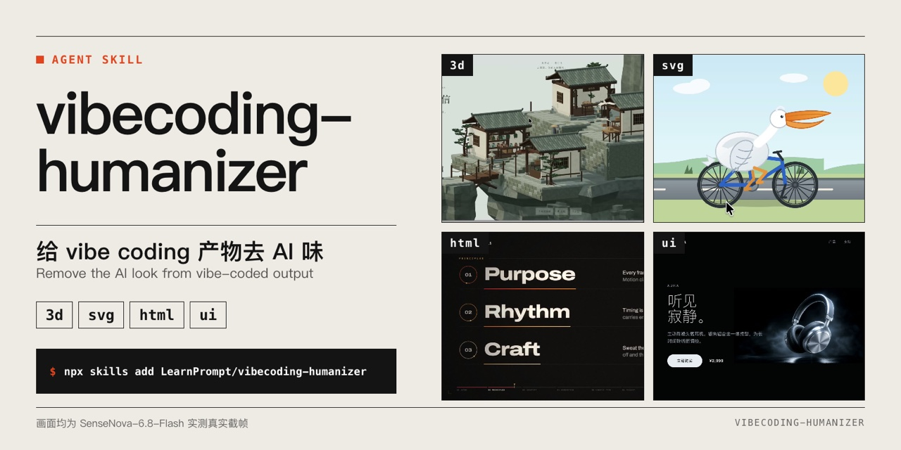
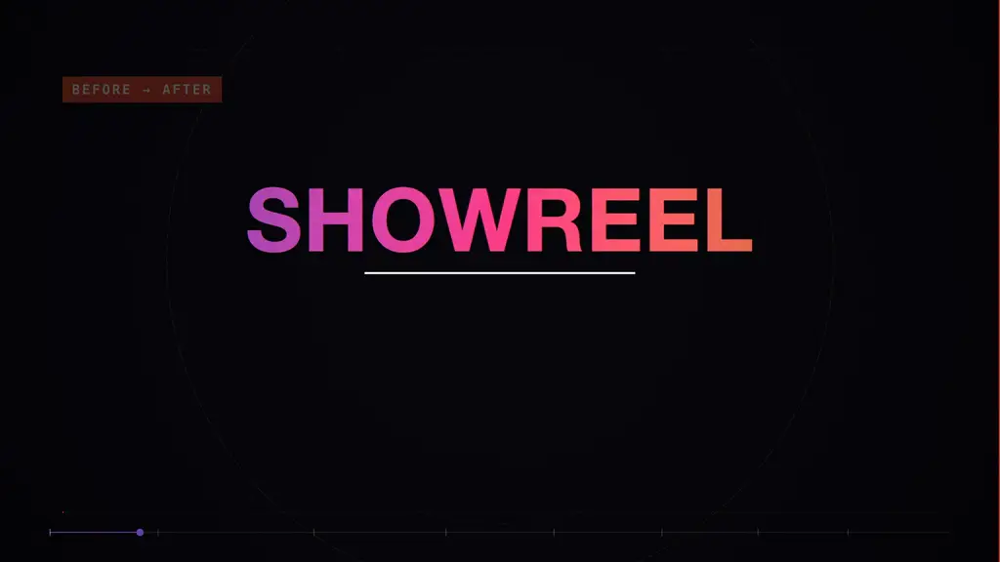
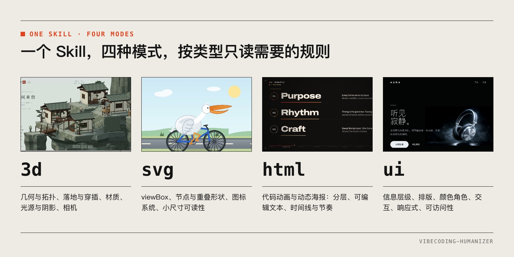
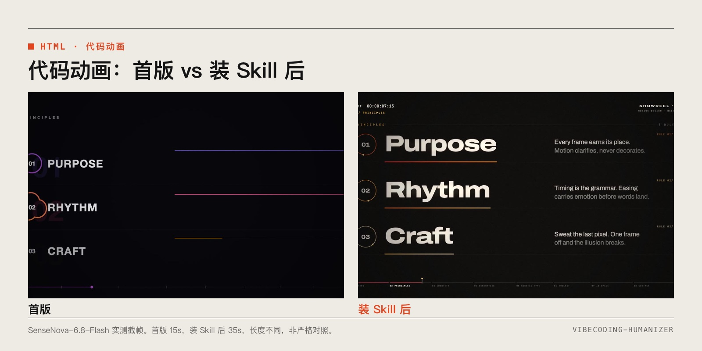
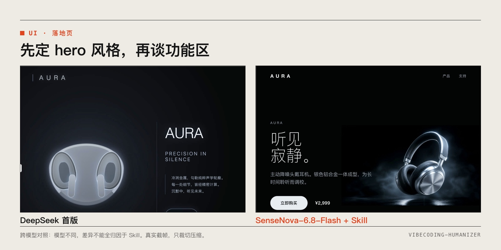
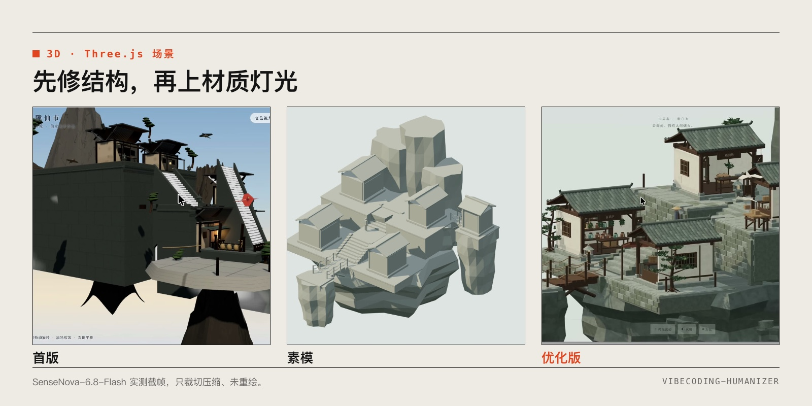

<p align="center"></p>

# vibecoding-humanizer

给 vibe coding 产物去 AI 味的一个 Skill：**3D 场景、SVG、HTML 动态海报与代码动画、UI 界面**，按类型加载不同规则，也支持混合场景。

A skill that removes the "AI look" from vibe-coded output — **3D scenes, SVG, HTML posters & code animations, and UI** — loading a different rule set per mode, with mixed-mode support.

```bash
npx skills add LearnPrompt/vibecoding-humanizer
```

<p align="center"></p>

<p align="center"><a href="assets/readme/promo-1080p.mp4">▶ 完整宣传片 30 秒 1080p，带配乐 / Full promo video (MP4)</a></p>

<p align="center"></p>

> 前身是 carl-ui-humanizer，0.3.0 起改名并扩展到四类产物，见[迁移说明](#从-carl-ui-humanizer-迁移--migrating)。Formerly `carl-ui-humanizer`; renamed and expanded in 0.3.0.

## 安装 / Install

用现成的 [Skills CLI](https://github.com/vercel-labs/skills)（`npx skills`），本仓库没有自己的 npm 包。Uses the existing Skills CLI; this repo ships no npm package of its own.

```bash
# 交互式选择 Agent（默认装到当前项目）/ interactive, project-level
npx skills add LearnPrompt/vibecoding-humanizer

# 只装给 Claude Code，跳过确认 / Claude Code only, non-interactive
npx skills add LearnPrompt/vibecoding-humanizer --skill vibecoding-humanizer -a claude-code -y

# 装到用户级（所有项目可用）/ user-level
npx skills add LearnPrompt/vibecoding-humanizer --skill vibecoding-humanizer -a claude-code -g -y
```

想关掉 Skills CLI 的匿名统计，在命令前加 `DISABLE_TELEMETRY=1`。To opt out of the CLI's telemetry, prefix with `DISABLE_TELEMETRY=1`.

不用 npx 也可以 Git 克隆到宿主的 Skill 目录（目标目录必须不存在）/ Or clone manually:

```bash
git clone https://github.com/LearnPrompt/vibecoding-humanizer.git ~/.claude/skills/vibecoding-humanizer
# Codex: "${CODEX_HOME:-$HOME/.codex}/skills/vibecoding-humanizer"
```

装好后重开会话，宿主才会发现新 Skill。Restart the agent session after installing.

## 怎么用 / Usage

在提示语里写 `类型：3d / svg / html / ui`，或直接用自然语言。这是提示语约定，不是命令行参数。Name the mode in your prompt (`mode: 3d / svg / html / ui`) or just describe the task.

| 模式 | 复制即用 / Copy-paste prompt |
|---|---|
| **3d** | 用 vibecoding-humanizer 按 3d 模式检查这个 Three.js 场景，优先修正悬浮、接触关系和光影，保留低多边形风格。 |
| **svg** | 用 vibecoding-humanizer 按 svg 模式清理这组图标：统一 viewBox 和描边，合并重叠路径，单色图标改 currentColor，在 24px 下检查可读性。 |
| **html** | 用 vibecoding-humanizer 按 html 模式改这支代码动画：去掉没信息量的英文小字，拉开字号字重对比，转场别每幕都一样，改完实际播放检查。 |
| **ui** | 用 vibecoding-humanizer 按 ui 模式检查这个落地页，先定 hero 风格，不堆功能区，保留必要的表单标签和价格。 |
| **混合 / mixed** | 类型：html，内嵌 svg；整理这张动态海报的文本层、SVG 路径和动画节奏，保留品牌与内容。 |
| **混合 / mixed** | 类型：ui，HTML 实现；先检查表单状态与阅读顺序，动效只保留与操作反馈有关的。 |

English: *"Use vibecoding-humanizer in 3d mode: fix floating objects, contact and lighting first; keep the low-poly style."*

**规则怎么分 / How modes split**

- **3d**：几何与拓扑、落地与穿插、材质、明确光源与阴影、相机、多视角；先结构后材质灯光。PBR 贴图不烘焙阴影高光 ≠ 场景禁用光影；low-poly 可以是主动风格。
- **svg**：viewBox、节点与重叠形状、图标系统、小尺寸可读性。小数精度 ≠ 节点数；多色插画不一律 currentColor。
- **html**：代码动画与动态海报的分层、可编辑文本、时间线与节奏。CSS 不是性能魔法；不把 UI 减动效规则套到叙事作品。
- **ui**：信息层级、排版、颜色角色、交互、响应式、可访问性；沿用 0.2.0 的八维流程和 13 条诊断。去 AI 味 ≠ 永远禁紫色/圆角/渐变。

`html` 是实现载体，`ui` 是设计目标，可以叠加。详见 [SKILL.md](SKILL.md)。

## 前后效果 / Before & After

用商汤 SenseNova-6.8-Flash 实测的真实截帧，只裁切压缩、未重绘。完整说明、来源时间点和局限见 [examples/](examples/README.md)。Real frames, cropped and compressed only.

**代码动画 / Code animation**（html；首版 15s vs 装 Skill 后 35s，长度不同，非严格对照）



**UI**（**跨模型对照**：DeepSeek 首版 vs SenseNova + Skill，模型不同，差异不能全归因于 Skill / cross-model, not a controlled test）



**3D**（3d；首版仅 Three.js → 素模 → 优化版）



**SVG / 动态海报**：只有成果、没有前版，所以不做对比。Results only, no "before" exists, so none is shown. 鹈鹕骑单车见 [examples/](examples/README.md)。

## 包含什么 / What's inside

```text
vibecoding-humanizer/
├── SKILL.md                  # 路由：选模式、混合规则、共用规则
├── references/
│   ├── mode-3d.md            # 3d 规则
│   ├── mode-svg.md           # svg 规则
│   ├── mode-html.md          # html：动态海报 + 代码动画
│   ├── code-animation.md     # 代码动画细则（html 模式引用）
│   ├── mode-ui.md            # ui：八维流程 + 13 条诊断
│   ├── prompt-library.md     # 14 条 UI 提示语
│   └── aesthetic-reference.md 等来源与对照材料
├── examples/                 # 前后效果与来源索引
├── agents/openai.yaml
├── VALIDATION.md
└── assets/
    ├── readme/               # 宣传片与 README 宣传图
    └── source-luinlee.png
```

每次只按模式读取需要的文件，不会把四套规则一起塞进上下文。Only the files for the chosen mode are read.

## 从 carl-ui-humanizer 迁移 / Migrating

- 仓库由 `LearnPrompt/carl-ui-humanizer` 改名为 `LearnPrompt/vibecoding-humanizer`，提交历史保留，GitHub 会把旧地址跳转到新地址。
- Skill 名从 `carl-ui-humanizer` 改为 `vibecoding-humanizer`。装过旧版的，先删旧目录（或 `npx skills remove carl-ui-humanizer`），再按上面的命令装新版。
- 原 13 条 UI 规则和八维流程没有删改，移到了 `references/mode-ui.md`。

## 边界 / Limits

- 规则来自作者实测和原帖整理，是经验规则，不是对所有模型的普遍结论；示例评价是作者主观观感。
- 不把所有卡片、渐变、英文小标题、阴影、low-poly 当错误；用户明确的风格优先。
- 不包含检测服务、自动评分、联网 SDK 或自有 CLI。验证范围见 [VALIDATION.md](VALIDATION.md)。

## 致谢 / Credits

- 条目结构参照 [blader/humanizer](https://github.com/blader/humanizer)（快照修订 `8c307f3`，读取于 2026-10-28）。
- 去冗余核心原则来自 Zihua（@luinlee）：*Avoid unnecessary secondary labels and descriptions. Let the layout do the explaining.*
- UI 来源、中英原句与翻译边界见 [原始素材](references/original-materials.md) 与 [来源覆盖](references/source-coverage.md)；Anthropic 前端审美提示按 MIT 许可完整保留。
- 安装依赖 [vercel-labs/skills](https://github.com/vercel-labs/skills)。可选的生成后审计：[Hallmark](https://github.com/Nutlope/hallmark)、[Impeccable](https://github.com/pbakaus/impeccable)、[Taste Skill](https://github.com/Leonxlnx/taste-skill)。

## 许可 / License

本仓库自己写的规则、文档和示例按 [MIT](LICENSE) 许可。引用的第三方内容保留各自的条款：Anthropic 前端审美提示按其 MIT 许可转载，协议全文在 [references/anthropic-prompts-en-zh.md](references/anthropic-prompts-en-zh.md) 末尾；其余引用的原帖句子归原作者所有，出处见[原始素材](references/original-materials.md)。

Rules, docs and examples written for this repo are released under the [MIT License](LICENSE). Quoted third-party material keeps its own terms: the Anthropic frontend aesthetics prompts are reproduced under their MIT license (full text at the end of `references/anthropic-prompts-en-zh.md`); other quoted sentences belong to their original authors, with sources listed in `references/original-materials.md`.
