# 前后效果展示 / Before & After

全部图片来自作者 2026-11-04 ~ 11-05 在商汤小浣熊里用 **SenseNova-6.8-Flash** 做的实测录屏与截图，只做了**裁切、等比缩放和 JPEG 压缩**，没有重绘。原始视频和原图保留在作者素材包里，未放进仓库；下表写明每张图对应的原文件和时间点。

All images are cropped, scaled and compressed from the author's real screen recordings and screenshots (SenseNova-6.8-Flash inside SenseTime's Xiaohuanxiong app). Nothing was redrawn. Source files and timestamps are listed per case.

**评价是作者的主观观感，不是评测分数。** 提示语全文、迭代轮数和完整执行日志未记录，下文写「未记录」的地方就是没有。

素材包路径前缀：`20261105-商汤-vibecoding-humanizer/docs/01-feishu/assets/`（下称 `assets/`）。

---

## 1. 代码动画 · html 模式

| | 首版 / First | 装 Skill 后 / With Skill |
|---|---|---|
| 三原则页 | 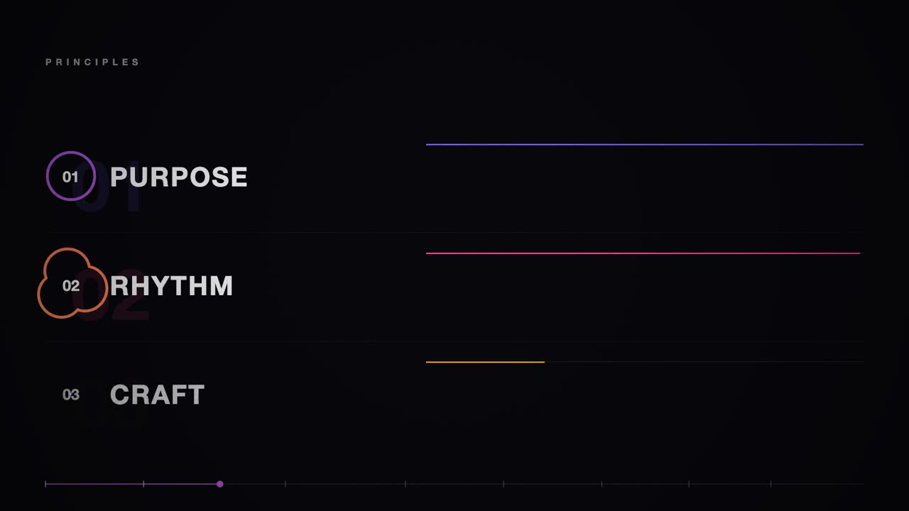 | 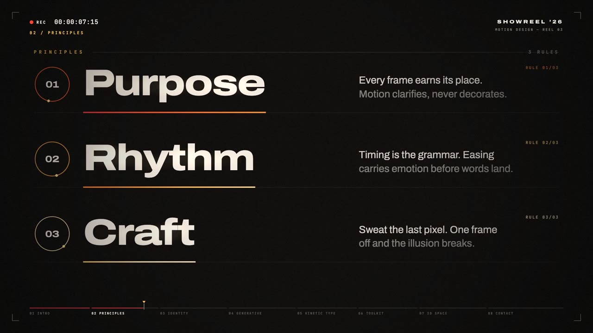 |
| logo 页 | 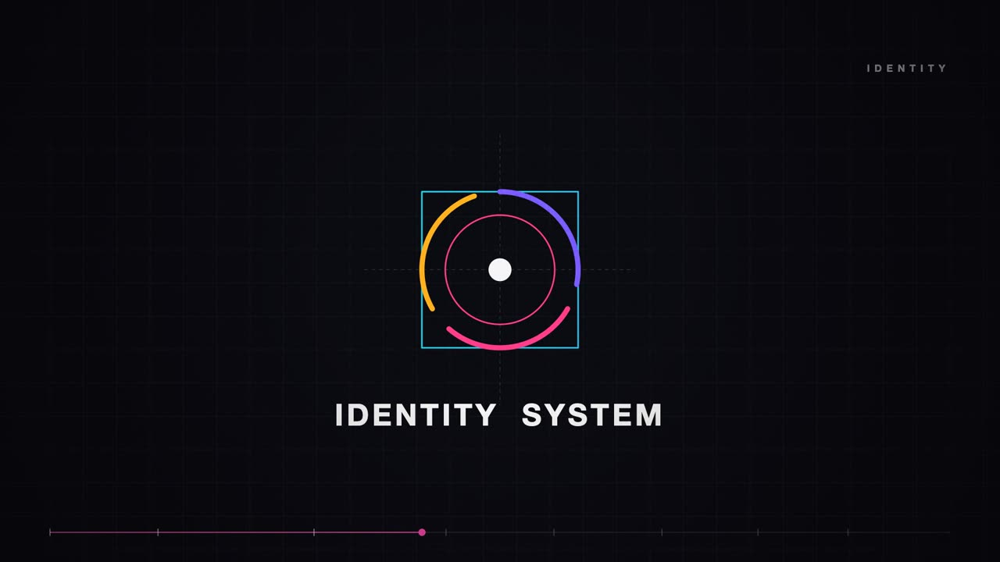 | 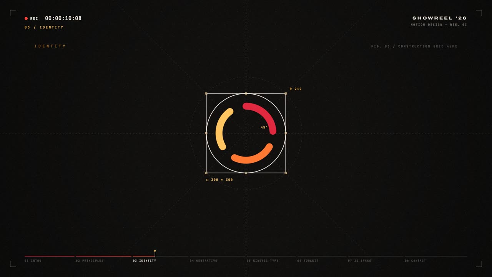 |
| 动态字 | 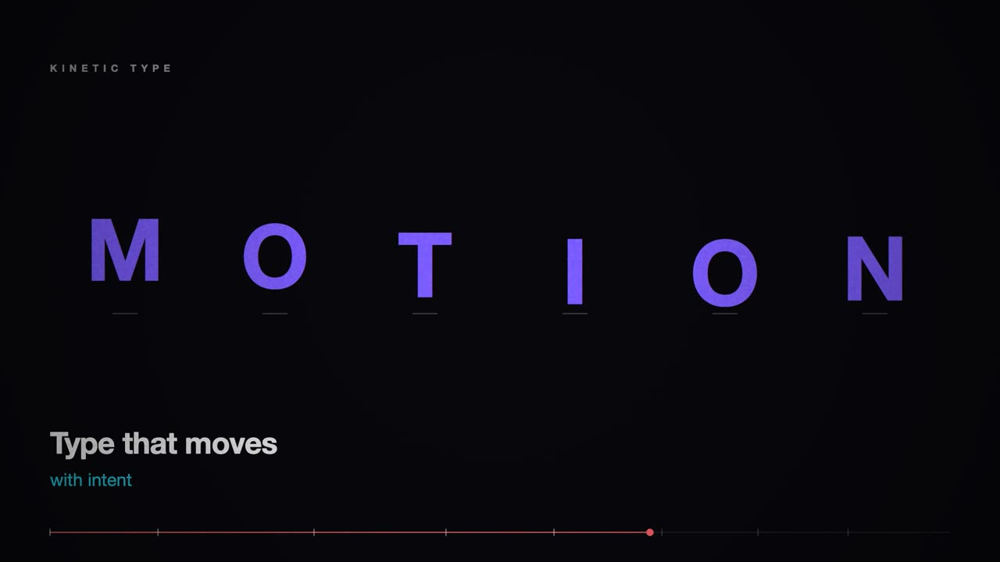 | 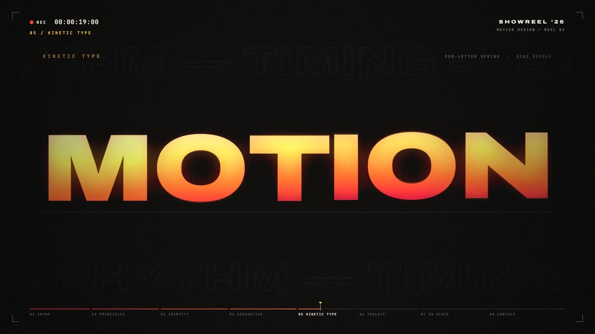 |

- **任务**：一条提示语「做一支 15 秒动态图形 showreel，展示你是顶尖动效设计师」，写代码再逐帧渲染成视频。
- **初始条件**：新环境，没装视频制作 Skill、HyperFrames Skill 和 Playwright，装什么由模型自己判断（日志显示它装了 Playwright-core，用 Canvas 合成后逐帧截取，再用 ffmpeg 编码）。
- **改了什么**：装入本 Skill 后重跑。可见变化：配色收敛为暖色，大字粗细对比拉开，三原则配了说明短句，转场方式更多样。
- **作者评价**：首版已在预期之上，但字形全片一致、转场节奏固定、大留白配左上角英文小字，像当年的 AI PPT；logo 圆环细微超出外框。优化版在作者主观观感上接近 Opus 5.5 风格的八九成。
- **局限**：首版 15 秒、优化版 35 秒，长度和提示语轮次不同，**不是严格的控制变量对照**。动画节奏要看视频，静帧只能对照版式。优化版仍保留时间码等小字 HUD。
- **来源**：首版 `assets/003/showreel_2026.mp4` 的 3.2s / 6.2s / 10.0s；优化版 `assets/006/yh5Ue-Og1XYwwHhzoecwCA.mp4` 的 7.5s / 10.3s / 19.0s。

## 2. UI · ui 模式（跨模型对照）

| DeepSeek 首版 | SenseNova-6.8-Flash + Skill |
|---|---|
| 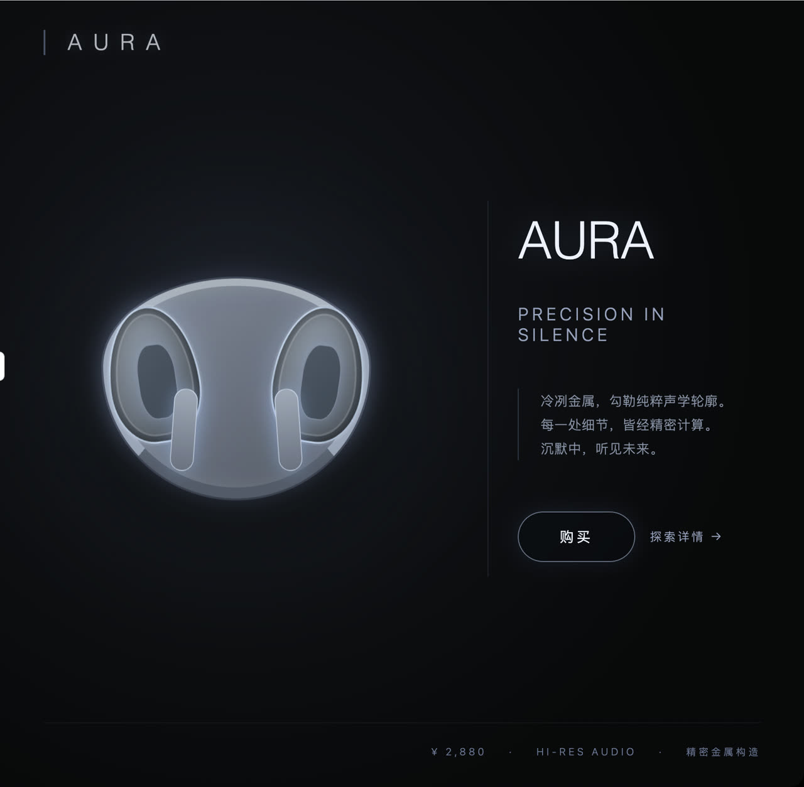 |  |
| | 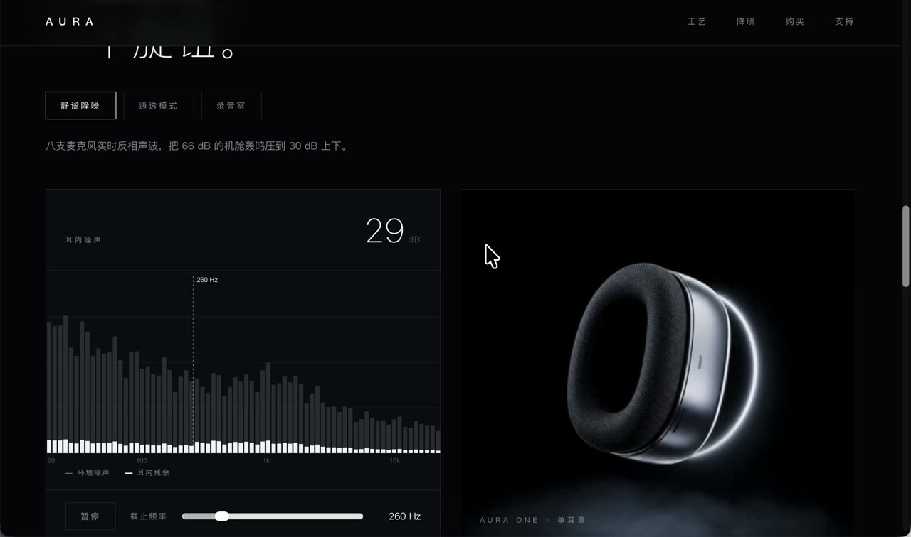 |

- **注意**：这是 **DeepSeek 生成结果 vs 商汤模型 + Skill 结果** 的并列，模型、流程都不同，**不能**当作同一模型只改变 Skill 的实验，差异不能全部归因于 Skill。DeepSeek 版本号未记录。
- **任务**：为虚构耳机品牌 AURA 做官网首页，深黑背景、银色金属耳机、冷白轮廓光。
- **改了什么**：商汤侧日志记录装入的是本 Skill 改名前的 `carl-ui-humanizer v0.1.1`。流程是先生成主视觉图，再主动检查是否达标，再按方法建首页；首屏只留品牌、主标题、一句副文、购买按钮和价格，导航只剩两项；先定首页风格再出后续页面。
- **作者评价**：黑色网页最难做，DeepSeek 这版一看就踩 AI 味；Skill 版不再出现顶栏一堆按钮。
- **局限**：页面里的价格、参数是生成内容，不是真实商品信息。完整提示语与轮次未记录。
- **来源**：`assets/007/image.png`（右侧页面区域）；`assets/008/image.png`（右侧页面区域）；`assets/009/AURA 2026-11-05_01-09-12-3024x1900-20261105010955.mp4` 的 3.7s（裁掉浏览器地址栏）。

## 3. 3D · 3d 模式

| 首版（仅 Three.js） | 素模阶段 | 优化版 |
|---|---|---|
| 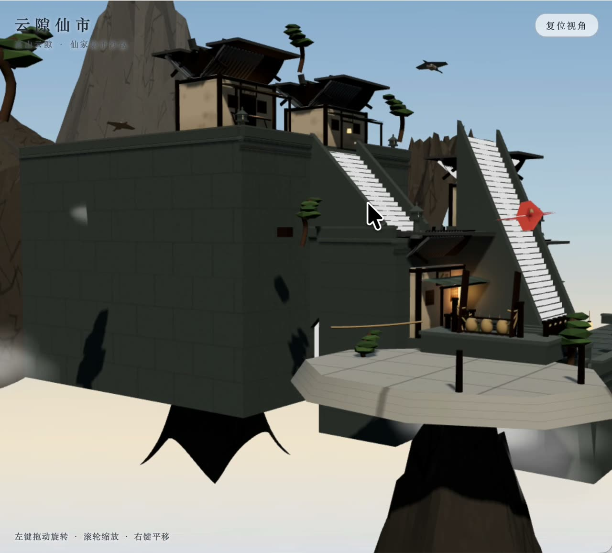 | 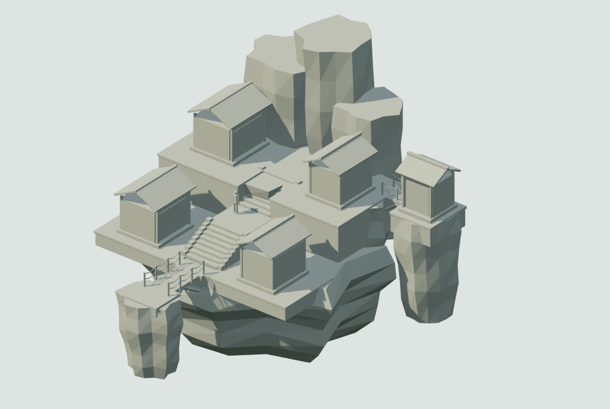 | 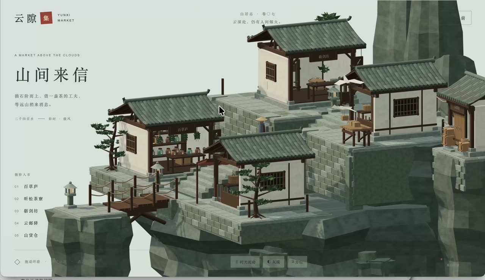 |
| 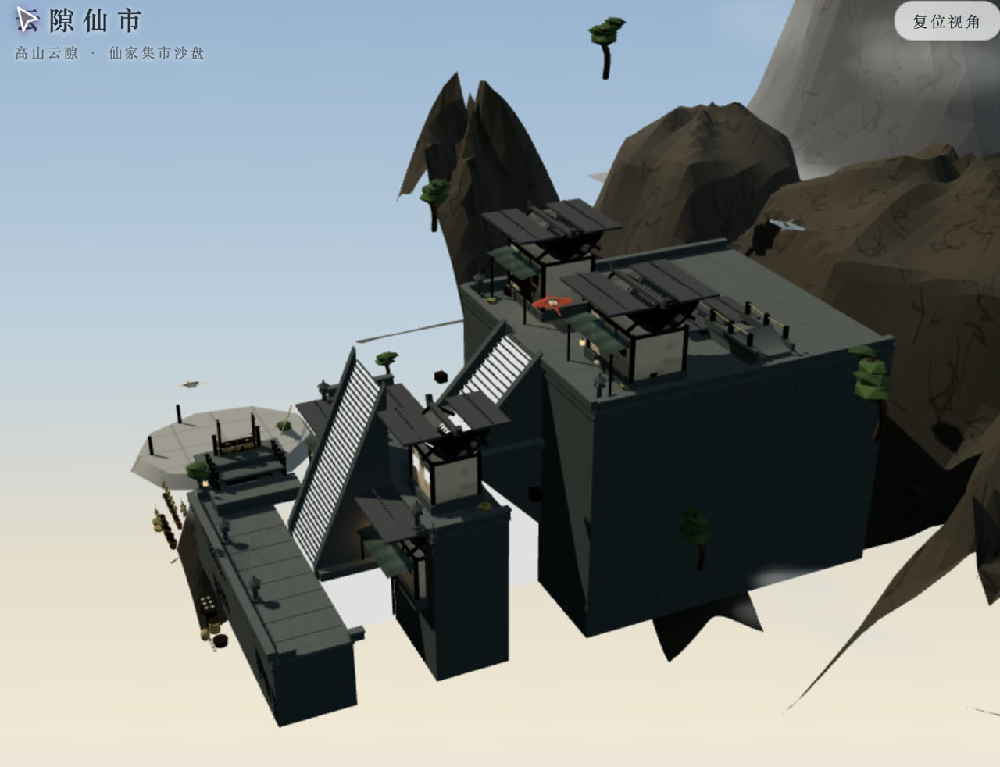 | | |
| 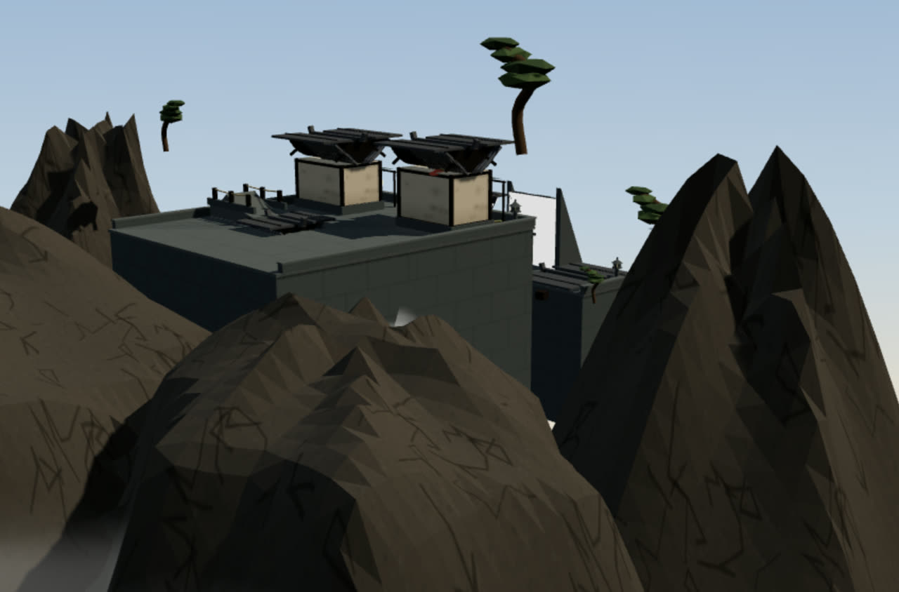 | | |

- **任务**：一座云上仙家集市沙盘。首版限定 Three.js、不用 Blender；优化阶段允许 Blender（是否实际使用了 Blender 未记录）。
- **首版问题（作者原话整理）**：第一级台阶被抬高；山体是带锯齿的金字塔形；山侧纹理是无序黑线；树浮在半空。
- **改了什么**：先定几何和拓扑（素模图），再单独调材质与灯光；加入物理合理性约束。
- **作者评价**：几何体没有复杂很多，但青砖瓦分色、房屋结构和重构后的鹤表现完全不同，物理性 bug 基本消除。
- **局限**：首版与优化版页面标题不同（云隙仙市 / 山间来信），视角不完全一致；素模图出现在分阶段说明中，作为中间稿展示，不单独标为前版或后版。
- **来源**：首版 `assets/010/商汤小浣熊 2026-11-04_23-53-35-2526x1898-20261104235734.mp4` 的 4.9s（裁掉左侧对话面板）、`assets/011/image.png`、`assets/012/image.png`；素模 `assets/014/image.png`；优化版 `assets/013/Area 2026-11-05_02-30-39-2976x1722-20261105023153.mp4` 的 3.5s。

## 4. SVG 与动态海报 · svg / html + svg 模式（只有成果，没有前版）

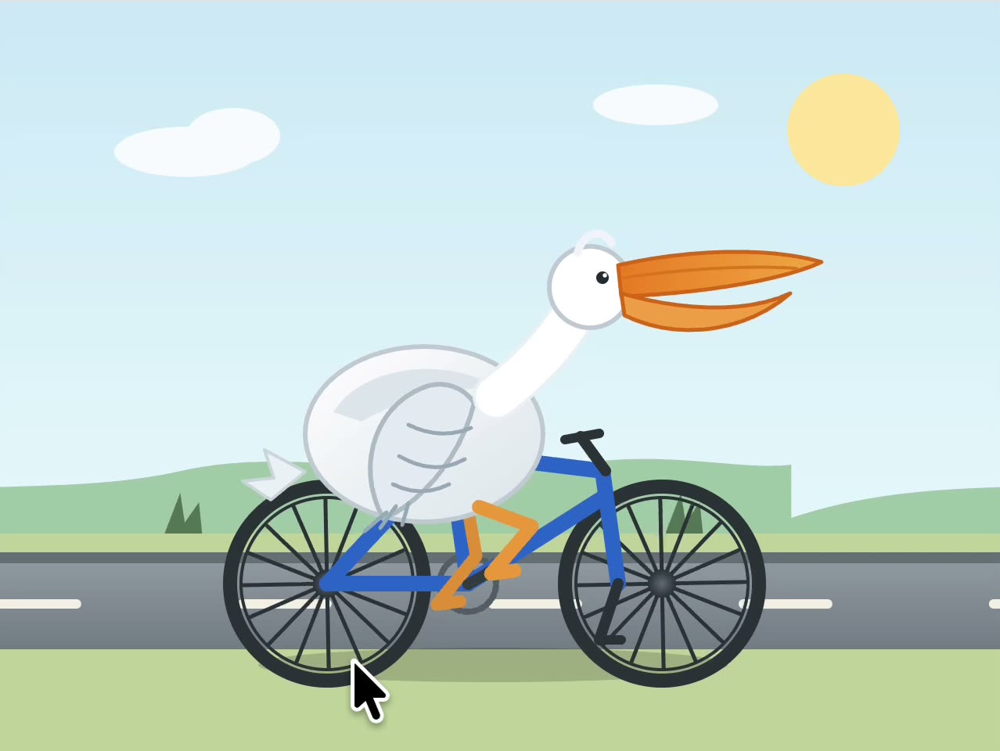

- **鹈鹕骑单车（svg）**：经典 SVG 测试题的成果展示，日志里模型自己确认了 SMIL 动画在跑、腿连着踏板。**这不是动态海报的改前版本。** 来源：`assets/015/商汤小浣熊 2026-11-05_11-02-46-2534x1900-20261105110304.mp4` 的 3.0s（只保留画布区域）。
- **动态海报《修缮之间：看见太和门》（html + svg）**：标题、图注、数值是独立 HTML 文本层，边框是 SVG，动效由 CSS keyframes 驱动。**没有对应的改前版本，所以只展示成果，不做对比。** 海报使用了故宫博物院、新京报、浦峰摄影及 Gisling（CC BY 3.0）的照片，再分发权限不确定，**本仓库不收录海报图片**；成果见作者的公众号文章。来源：`assets/016/…mp4`、`assets/017/image.png`。

---

截图前已检查：裁掉了浏览器地址栏里的本机路径和与展示无关的对话面板；画面里没有账号、令牌或私人聊天。
